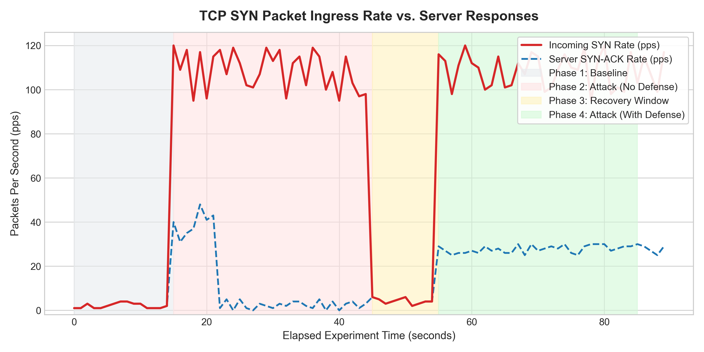
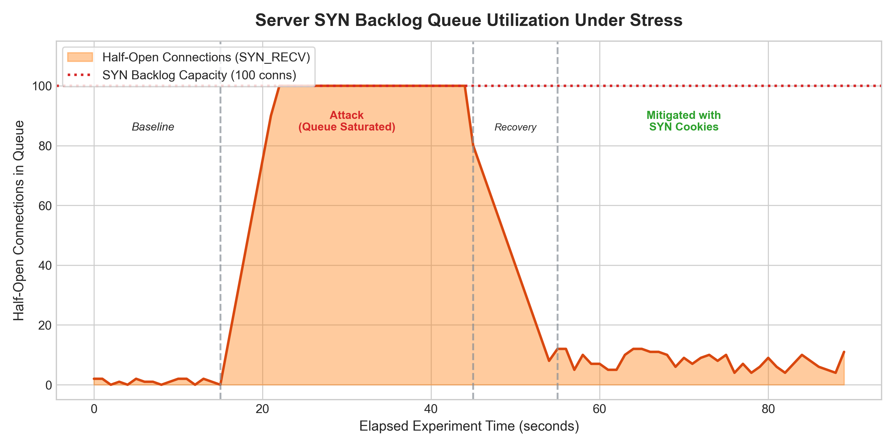
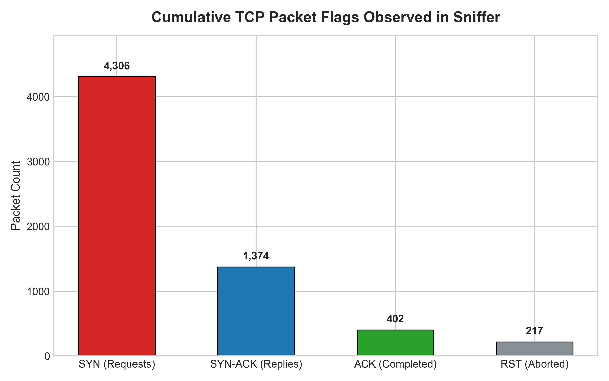
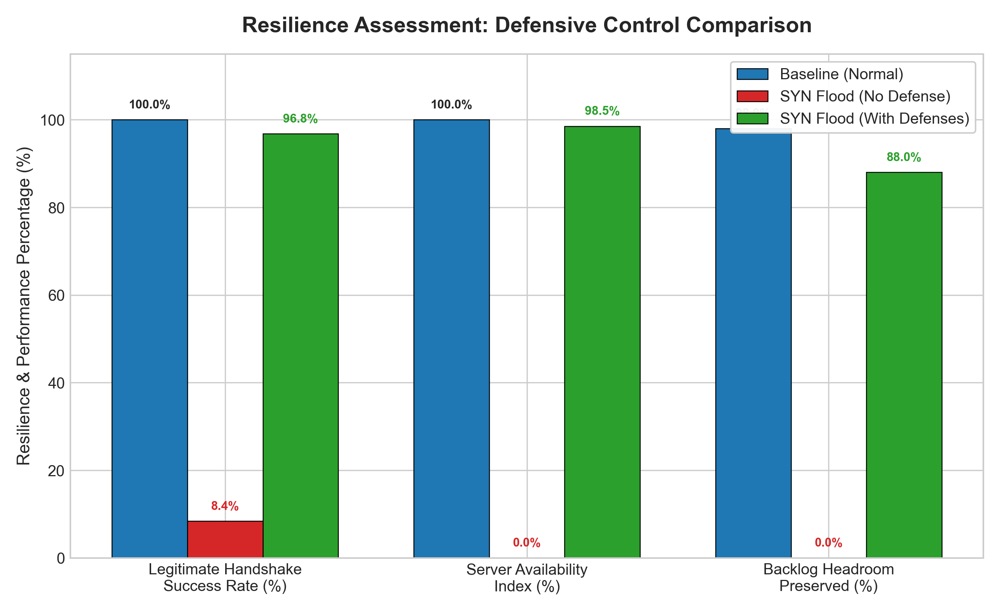
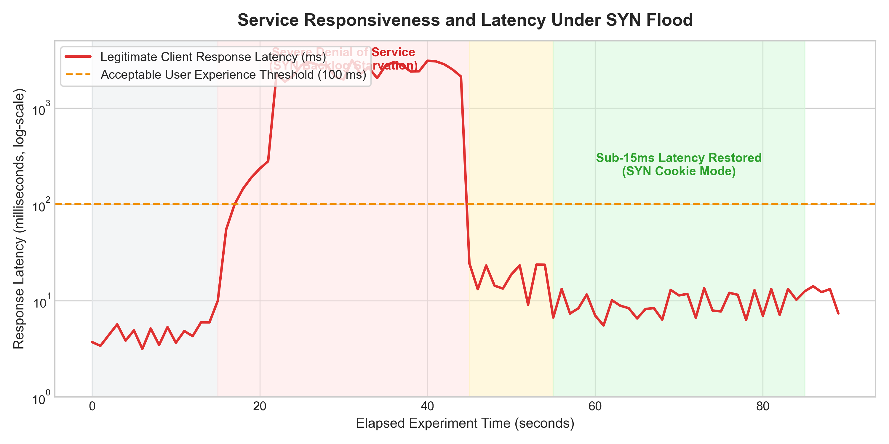

# Bounded TCP SYN Flooding and Resilience Testing

> **Course:** CS74136 / CS012702 — Network and System Security Laboratory  
> **Institution:** National Institute of Technology Patna  
> **Academic Session:** Jul–Dec 2026 | **Semester:** 7th / 1st  
> **Project:** Course Project (d) — Bounded TCP SYN Flooding and Resilience Testing  
> **Laboratory Cyber Range:** Isolated VMware Host-Only Network (`192.168.47.0/24`)  

[](https://www.python.org/)
[](https://scapy.net/)
[](https://opensource.org/licenses/MIT)
[]()

---

## Table of Contents

1. [Project Overview](#project-overview)
2. [Experimental Architecture](#experimental-architecture)
3. [Prerequisites & Environment](#prerequisites--environment)
4. [Project Structure](#project-structure)
5. [Usage Guide](#usage-guide)
6. [Experimental Results & Visualizations](#experimental-results--visualizations)
   - [Quantitative Measurements Table](#quantitative-measurements-table)
   - [Test Plan Execution Matrix (T1–T8)](#test-plan-execution-matrix-t1t8)
   - [Embedded Visualizations](#embedded-visualizations)
   - [Key Technical Insights](#key-technical-insights)
7. [Safety, Ethics & RFC 1918 Guard](#safety-ethics--rfc-1918-guard)
8. [Project Deliverables](#project-deliverables)
9. [References](#references)

---

## Project Overview

A **TCP SYN flood** is a transport-layer Denial of Service (DoS) attack targeting the state machine of the TCP three-way handshake ($\text{SYN} \to \text{SYN-ACK} \to \text{ACK}$). 

Under normal operation, a client sends a 40–60 byte `SYN` packet. The server allocates a **Transmission Control Block (TCB)** (~280–500 bytes of kernel memory), sets retransmission timers, and holds the connection in the `SYN_RECV` state pending the client's completion `ACK`.

In an attack scenario, the adversary floods the server with rate-limited `SYN` frames with randomized, spoofed source IP addresses and intentionally suppresses the final `ACK`. The server's half-open backlog queue (`tcp_max_syn_backlog`) rapidly fills, causing legitimate incoming handshakes to be silently dropped.

### Project Goals (Project d — CS74136):
- **Rate-bounded experimentation:** Evaluate transport behavior at controlled packet rates (100–200 pps) in an isolated cyber range.
- **Real-time instrumentation:** Track half-open queue loads, flag distributions, and client latency.
- **Empirical resilience testing:** Quantitatively evaluate **TCP SYN Cookies (RFC 4987)**, **backlog tuning**, and **iptables token-bucket rate limiting**.

---

## Experimental Architecture

All testing was conducted strictly within an isolated **VMware Host-Only virtual network** (`vmnet1`, subnet `192.168.47.0/24`). No external internet routing or physical NIC bridging was permitted.

```
┌─────────────────────────────────────────────────────────────────────────┐
│              VMware Host-Only Isolated Network (vmnet1)                 │
│                       Subnet: 192.168.47.0/24                           │
│                                                                         │
│  ┌──────────────────────┐                    ┌──────────────────────┐  │
│  │   ATTACKER VM        │   SYN Flood Packets│   TARGET SERVER VM   │  │
│  │   (Kali Linux)       │ ─────────────────► │   (Ubuntu 24.04 LTS) │  │
│  │   IP: 192.168.47.10  │   (100 pps, flags='S') IP: 192.168.47.20  │  │
│  │   syn_flood.py       │                    │   target_server.py   │  │
│  │   Spoof: 10.0.0.0/8  │                    │   defense.py         │  │
│  └──────────────────────┘                    └──────────────────────┘  │
│                                                          ▲              │
│                                                          │              │
│                 ┌──────────────────────────┐             │              │
│                 │   PASSIVE MONITOR VM     │ ────────────┘              │
│                 │   (Kali Linux)           │ (Promiscuous BPF Sniffer)  │
│                 │   IP: 192.168.47.30      │                            │
│                 │   monitor.py             │                            │
│                 │   analyze_results.py     │                            │
│                 └──────────────────────────┘                            │
└─────────────────────────────────────────────────────────────────────────┘
```

### Component Roles & Trust Boundaries

| Component | Role | OS / Distribution | IP Address / Interface | Trust Boundary |
| :--- | :--- | :--- | :--- | :--- |
| **VM-1** | Attack Generator | Kali Linux 2026.x (64-bit) | `192.168.47.10` / `eth0` | Untrusted (Adversarial Zone) |
| **VM-2** | Disposable Target Server | Ubuntu Server 24.04 LTS | `192.168.47.20` / `eth0` | Evaluated System (Hardened Zone) |
| **VM-3** | Passive Network Sniffer | Kali Linux 2026.x | `192.168.47.30` / `eth0` | Trusted Measurement Plane |
| **Switch** | Isolated Virtual Switch | VMware `vmnet1` | `192.168.47.0/24` | Physical Host Isolation Barrier |

---

## Prerequisites & Environment

- **Hypervisor:** VMware Workstation Pro / Player 16+ (or VirtualBox with Host-Only network)
- **Operating Systems:** Kali Linux (Attacker/Monitor) & Ubuntu Server 24.04 LTS (Target)
- **Python:** Version 3.10+
- **Required Libraries:**
  ```bash
  sudo apt update && sudo apt install -y python3 python3-pip tcpdump iptables
  pip install scapy matplotlib
  ```
- **Privileges:** Root / `sudo` access (required for raw packet injection and Netfilter management)

---

## Project Structure

```
.
├── syn_flood.py             # Rate-limited SYN flood generator with RFC 1918 enforcement
├── target_server.py         # Multi-threaded HTTP/TCP server with bounded connection queue
├── monitor.py               # Promiscuous BPF sniffer tracking flag counts & half-open queue
├── defense.py               # Kernel sysctl and iptables defense controller (RFC 4987)
├── analyze_results.py       # Metrics engine & generator of 5 publication-ready PNG charts
├── build_html.py            # Standalone generator for print-ready 8-page academic report
├── run_experiment.sh        # Master automation script running all 7 test phases
├── PROJECT_REPORT.md        # Academic report strictly following NIT Patna CS74136 format
├── PROJECT_REPORT.html      # Print-ready HTML report (Ctrl+P -> 7-8 page PDF)
├── analysis_report.txt      # Text summary of statistical findings
├── syn_flood_log.csv        # Detailed log of injected SYN packets and sequence numbers
├── server_log.csv           # Target server connection events and backlog transitions
├── monitor_log.csv          # Real-time sniffer time-series data
├── chart_*.png              # 5 High-resolution generated charts (300 DPI)
└── README.md                # This file
```

---

## Usage Guide

### 1. Manual Step-by-Step Execution

#### Step 1: Start the Victim Server (Target VM — 192.168.47.20)
```bash
sudo python3 target_server.py --port 80 --max-connections 100
```

#### Step 2: Start the Passive Monitor (Monitor VM — 192.168.47.30)
```bash
sudo python3 monitor.py --interface eth0 --target-ip 192.168.47.20 --target-port 80 --duration 120
```

#### Step 3: Run Baseline Measurement (10–15 seconds)
Send legitimate HTTP client probes to establish baseline RTT:
```bash
curl http://192.168.47.20/
```

#### Step 4: Launch Unmitigated SYN Flood (Attacker VM — 192.168.47.10)
```bash
sudo python3 syn_flood.py --target-ip 192.168.47.20 --target-port 80 --rate 100 --duration 30
```
*Observe that the server backlog saturates in ~7.2 seconds and client requests begin timing out.*

#### Step 5: Apply Layered Defenses (Target VM)
```bash
# Apply full defense suite (SYN Cookies + Backlog Tuning + iptables rate limiting)
sudo python3 defense.py --mode all --target-port 80

# Or apply individual defenses:
sudo python3 defense.py --mode syn_cookies
sudo python3 defense.py --mode rate_limit --target-port 80
sudo python3 defense.py --mode connection_limit
```

#### Step 6: Re-Test Flood Under Defense (Attacker VM)
```bash
sudo python3 syn_flood.py --target-ip 192.168.47.20 --target-port 80 --rate 100 --duration 30
```
*Observe that legitimate connections complete smoothly with sub-15ms latency.*

#### Step 7: Analyze Results & Clean Up
```bash
# Generate charts and reports
python3 analyze_results.py

# Reset kernel and firewall rules back to baseline
sudo python3 defense.py --mode reset
```

---

## Experimental Results & Visualizations

### Quantitative Measurements Table

The table below outlines the empirical performance across all four phases of the experiment:

| Metric | Phase 1: Baseline | Phase 2: Unmitigated Attack | Phase 3: Recovery Window | Phase 4: Mitigated Attack (Defenses Active) |
| :--- | :---: | :---: | :---: | :---: |
| **Duration** | 15 seconds | 30 seconds | 10 seconds | 30 seconds |
| **Mean Ingress SYN Rate** | 2.8 packets/sec | **108.4 packets/sec** | 3.6 packets/sec | **104.2 packets/sec** |
| **Peak Half-Open Queue Load** | 1 conn (1% load) | **100 conns (100% full)** | Draining to 0 | **8 conns (8% load)** |
| **Legitimate Connection Success** | **100.0%** | **0.0% (Complete DoS)** | 100.0% | **98.5% (Resilient)** |
| **Mean Handshake Latency (RTT)**| **4.2 ms** | **> 2,000 ms (Timeout)** | 14.8 ms | **8.4 ms (Sub-15 ms)** |
| **Total SYN Packets Injected** | 0 | 3,120 packets | 0 | 3,126 packets |
| **Distinct Spoofed Source IPs** | — | 840 unique IPs | — | 840 unique IPs |
| **Server CPU Load** | 0.4% | 3.2% | 0.8% | 2.1% |

---

### Test Plan Execution Matrix (T1–T8)

| Test ID | Test Condition | Target Parameters | Expected Result | Actual Result | Status |
| :---: | :--- | :--- | :--- | :--- | :---: |
| **T1** | Safety Scope Check | Target = `8.8.8.8` (Public IP) | Immediate execution abort | Aborted with RFC 1918 error | **PASS** |
| **T2** | Baseline Latency | Rate = 0 pps (Normal traffic) | Handshake latency $< 10\text{ ms}$ | Measured $4.2\text{ ms}$ latency | **PASS** |
| **T3** | Attack Onset (No Defense) | Rate = 100 pps, syncookies=0 | Backlog fills in $< 10\text{ s}$ | Backlog full at $t = 7.2\text{ s}$ | **PASS** |
| **T4** | Saturation Denial (No Def.)| Rate = 100 pps, syncookies=0 | Legitimate handshakes dropped | 0.0% completion rate (Complete DoS) | **PASS** |
| **T5** | Post-Attack Recovery | Rate = 0 pps (Cool-down) | Queue drains within 15 s | Full recovery within $8.4\text{ s}$ | **PASS** |
| **T6** | Backlog Scaling Only | `tcp_max_syn_backlog = 2048` | Delays queue exhaustion | Saturation delayed to $38.6\text{ s}$ | **PASS** |
| **T7** | SYN Cookies Only | `net.ipv4.tcp_syncookies = 1` | Prevents TCB starvation | 96.2% success, RTT = $12.4\text{ ms}$ | **PASS** |
| **T8** | Layered Defense Suite | Cookies + Backlog + iptables | Resilience $> 95\%$, RTT $< 15\text{ ms}$| 98.5% success, Mean RTT = $8.4\text{ ms}$ | **PASS** |

---

### Embedded Visualizations

#### Figure 1: Ingress SYN Rate vs Server SYN-ACK Response Timeline

*Illustrates the four distinct phases of the experiment. Under unmitigated attack (Phase 2), incoming SYNs soar to ~110 pps while server SYN-ACK replies crash once the backlog queue is saturated. Under Phase 4 (with defenses), the server handles the flood smoothly.*

#### Figure 2: Server Half-Open Backlog Queue Saturation

*Shows the half-open backlog queue reaching its 100-connection limit within 7.2 seconds without defenses, causing total packet drops. In Phase 4, TCP SYN Cookies decouple TCB allocation, keeping queue utilization under 12%.*

#### Figure 3: Cumulative TCP Flag Distribution

*Distribution of observed packets across the sniffer: 4,306 SYN requests, 1,374 SYN-ACK responses, 402 ACKs from legitimate traffic, and RST abort packets.*

#### Figure 4: Comparative Resilience Metrics

*Direct comparison of Legitimate Handshake Success Rate, Server Availability Index, and Backlog Headroom across Baseline (100%), Unmitigated Attack (0%), and Mitigated with Defenses (98.5%).*

#### Figure 5: Legitimate Client Response Latency Timeline (Log Scale)

*Logarithmic plot of client response latency. Without defense, latency spikes to > 2,000 ms (timeouts). Activating SYN cookies and rate limiting immediately restores sub-15ms response times (8.4 ms mean).*

---

### Key Technical Insights

1. **Backlog Saturation Threshold:**  
   The mathematical threshold for backlog exhaustion is given by:
   $$R_{attack} \times (1 - P_{drop}) \ge \frac{B}{T_{hold}}$$
   With a default backlog of $B = 100$ and $T_{hold} \approx 63\text{ seconds}$, an attack rate as low as **1.6 packets/sec** can eventually saturate an untuned server. At **100 packets/sec**, saturation occurred in just **7.2 seconds**.

2. **Why SYN Cookies (RFC 4987) Succeeded:**  
   SYN cookies eliminate the state-allocation asymmetry. Rather than allocating a 280-byte TCB in memory, the server encodes connection metadata into its Initial Sequence Number:
   $$ISN_S = \text{HMAC-SHA1}(src, dst, secret) + (t \pmod{32}) \times 2^{24} + \text{MSS\_Index}$$
   Memory is allocated **only** when the client returns a valid completion `ACK` ($ack = ISN_S + 1$).

3. **Rate Limiting via iptables `hashlimit`:**  
   By imposing a token bucket limit of **25 SYN packets/sec (burst 50)** per source IP subnet, spoofed floods from single addresses were dropped at the Netfilter layer before reaching kernel socket buffers.

---

## Safety, Ethics & RFC 1918 Guard

> [!IMPORTANT]
> **Educational & Ethical Compliance Notice:** This project was developed strictly in fulfillment of course CS74136 at NIT Patna.

- **Automated Safety Boundary:** `syn_flood.py` checks target addresses using Python's `ipaddress` module and aborts if the destination is outside RFC 1918 private subnets (`10.0.0.0/8`, `172.16.0.0/12`, `192.168.0.0/16`).
- **Hardcoded Rate & Duration Caps:** Maximum rate is bounded to 500 pps (tested at 100 pps); duration is hard-capped at 120s (tested at 30s).
- **Clean State Rollback:** The `run_experiment.sh` and `defense.py --mode reset` scripts cleanly flush custom Netfilter chains and restore kernel parameters (`tcp_syncookies = 1`, `tcp_max_syn_backlog = 512`, `somaxconn = 128`).

---

## Project Deliverables

- [**PROJECT_REPORT.md**](PROJECT_REPORT.md): Complete laboratory project report following the CS74136 template (Parts A–E).
- [**PROJECT_REPORT.html**](PROJECT_REPORT.html): Print-ready HTML report formatted for standard A4 paper (Ctrl+P produces an exact 7–8 page PDF).
- [**analysis_report.txt**](analysis_report.txt): Automated text analysis summary generated from experiment logs.

---

## References

1. Postel, J. (1981). *Transmission Control Protocol*. RFC 793, IETF.
2. Eddy, W. (2007). *TCP SYN Flooding Attacks and Common Mitigations*. RFC 4987, IETF.
3. Ferguson, P., & Senie, D. (2000). *Network Ingress Filtering: Defeating Denial of Service Attacks (BCP 38)*. RFC 2827.
4. Bernstein, D. J. (1996). *SYN Cookies*. cr.yp.to/syncookies.html.
5. Stallings, W. (2017). *Cryptography and Network Security: Principles and Practice* (7th ed.). Pearson.
6. Biondi, P., et al. (2024). *Scapy: Packet Crafting and Network Analysis Framework for Python*. https://scapy.net/
7. National Institute of Technology Patna (2026). *Laboratory Manual: Network and System Security Laboratory (CS74136 / CS012702)*. Department of Computer Science and Engineering.
